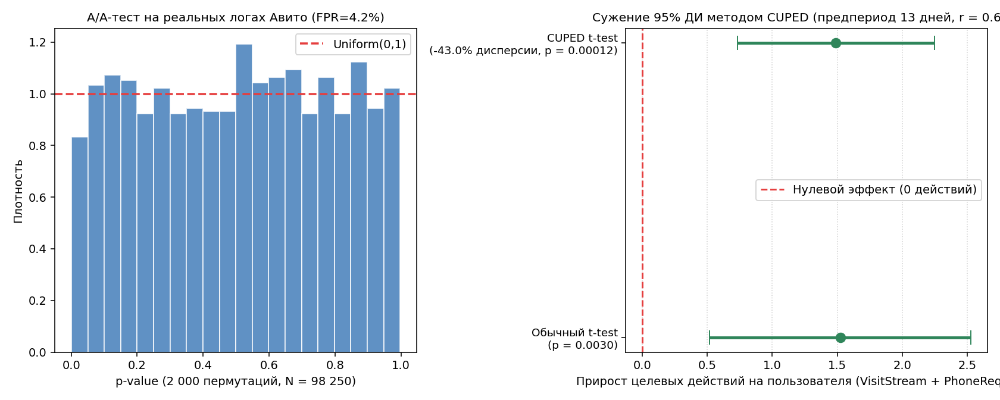

# A/B-тест и снижение дисперсии методом CUPED (`rel-avito`)

Расчет дизайна A/B-теста, проверка сплитования (SRM, A/A) и применение метода CUPED на пользовательских логах датасета *Avito Context Ad Clicks* (`rel-avito`, 25.04.2015 — 20.05.2015).



## Данные и пайплайн

Используются таблицы `UserInfo`, `SearchInfo`, `VisitStream`, `PhoneRequestsStream` и `AdsInfo` (N = 98 250 пользователей):

1. **Разбиение временного окна (26 дней):**
   - Предпериод (`2015-04-25` — `2015-05-07`, 13 дней) — ковариата `X` (просмотры карточек + запросы контакта на пользователя).
   - Тестовый период (`2015-05-08` — `2015-05-20`, 13 дней) — целевые метрики `Y`.
2. **Дизайн и валидация:**
   - Параметры: `α = 0.05`, мощность `1 - β = 80%`, относительный `MDE = 3.0%` для конверсии в запрос телефона (`CR`) и `4.5%` для числа целевых действий.
   - Проверка отсутствия Sample Ratio Mismatch (`χ²`) и симуляция 2 000 A/A-пермутаций на эмпирическом распределении (оценка `FPR` и KS-test).
3. **Снижение дисперсии (CUPED):**

$$Y_{\text{cuped}} = Y - \theta (X - \bar{X}), \quad \theta = \frac{\text{Cov}(Y, X)}{\text{Var}(X)}$$

   При одновременной проверке двух целевых метрик (`CR` и `Actions per User`) применяется поправка Холма — Бонферрони (`α_adj = 0.025`).

## Результаты

| Показатель | Control (n = 48 871) | Treatment (n = 49 379) | Разница / Эффект | Статистика |
| :--- | :---: | :---: | :---: | :---: |
| **SRM (χ²)** | 49.74% | 50.26% | — | p = 0.1051 |
| **A/A-тест (2 000 итераций)** | — | — | FPR = 4.15% | KS p = 0.4267 |
| **Конверсия в контакт (`CR`)** | 27.44% | 28.36% | +0.92 п.п. (+3.35%) | p = 0.00133 |
| **Целевые действия (обычный t-test)** | 30.72 | 32.25 | +1.52 (+4.96%) | 95% ДИ: ±1.01, p = 0.0030 |
| **Целевые действия (Bootstrap 2 000)** | 30.72 | 32.25 | +1.52 (+4.96%) | 95% ДИ: [0.51; 2.52] |
| **Целевые действия (CUPED)** | 30.75 | 32.24 | +1.49 (+4.85%) | 95% ДИ: ±0.76, p = 0.00012 |
| **Барьерная метрика (`search_bounce`)** | 28.88% | 29.02% | +0.14 п.п. | p = 0.6184 |

### Параметры CUPED

| Метрика | Корреляция r с предпериодом | θ | Снижение дисперсии | Сужение 95% ДИ | Выборка на группу (MDE = 4.5%) |
| :--- | :---: | :---: | :---: | :---: | :---: |
| **Целевые действия (`Visit + Phone`)** | 0.6560 | 0.4747 | -43.0% | -24.5% | 49 082 → 27 962 |
| **Сумма цен контактов (`AdsInfo.Price`)** | 0.6479 | 0.4612 | -42.0% | -23.8% | — |

## Структура и запуск

* `project_1_ab_cuped.py` — расчет дизайна, A/A-симуляции, CUPED и поправки Холма — Бонферрони.
* `ab_cuped_metrics.json` — выгрузка рассчитанных метрик.
* `ab_cuped_results.png` — распределение p-value на A/A-тесте и сравнение доверительных интервалов.

```bash
pip install -r requirements.txt
python project_1_ab_cuped.py
```
